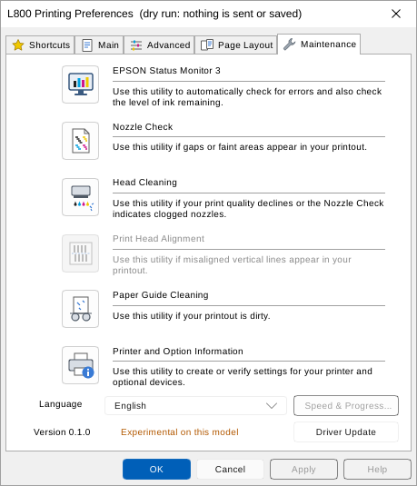
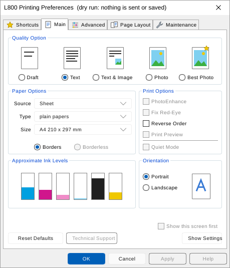

# escp-utility

Printing Preferences and maintenance for Epson inkjet printers on Linux,
laid out like the Windows driver: the five-tab property sheet (Shortcuts,
Main, Advanced, Page Layout, Maintenance), Nozzle Check, Head Cleaning, the
printer status with approximate ink levels (EPSON Status Monitor 3), and the
step-by-step dialogs between them. Rust and [Slint](https://slint.dev).




More: [Status Monitor](docs/screenshots/l800-status-monitor.png),
[Head Cleaning](docs/screenshots/l800-head-cleaning.png), an
[L805 sheet built from its PPD](docs/screenshots/l805-main-from-ppd.png) and
[Printer Options](docs/screenshots/et2750-printer-options.png). All are the
app's own offscreen renders (`cargo run --example screenshot -- DIR`).

## What is supported

| Printer | Level |
|---|---|
| **Epson L800** (USB) | Measured. The job bytes match the Windows L800 driver byte for byte; the status was read live on an L800 and its replies are test fixtures; Printing Preferences use the Windows L800 tables. Running the jobs on the printer is the last step, so the Maintenance tab still says "Experimental on this model" until its profile records that test. |
| Other Epson inkjets with ESC/P2 or ESC/P-R, on USB | Experimental baseline: what Epson's own Linux utility gives every model. Nozzle Check (`NC 00`), one Head Cleaning (`CH 00`), status and ink levels from the generic status reply, neutral texts. Printing Preferences come from the queue's PPD. |
| Network queues (IPP, socket, dnssd) | Printing Preferences only. Maintenance and status need the USB device. |

A printer counts as Epson ESC/P when its IEEE 1284 device ID says `MFG:EPSON`
and `CMD` lists `ESCPL2` or `ESCPR`, the same test as Epson's Linux utility. A
model profile (`profiles.toml`) can add more, such as the L800's Power
Cleaning. See [CONTRIBUTING.md](CONTRIBUTING.md) to add a model.

## Safety: what each action does

Nothing reaches the printer when the app starts, except the read-only status
request. Every job is one raw CUPS job (`lp -d <queue> -o raw`), as Windows
spools a RAW job; CUPS keeps the USB device.

| Action | What is sent | Cost |
|---|---|---|
| Opening the app, Status Monitor (every 5 s while open), the pre-check before each utility | The status request `st 01 00 01` on the IEEE 1284.4 control channel of `/dev/usb/lpN`. Only while the CUPS queue has no jobs. | None |
| Nozzle Check > Print | `NC 02 00 00 00` job, 132 bytes | One sheet of A4/Letter plain paper, a little ink |
| Head Cleaning > Start | `CH 02 00 00 00` job, 92 bytes | Ink (it goes to the waste ink pad) |
| Power Cleaning > OK (L800 profile only) | `CH 02 00 00 10` | Much more ink than a normal cleaning; use it only when three normal cleanings did not help |
| Paper Guide Cleaning (L800) | Nothing. Windows sends an empty job here too | None |
| OK / Apply on the sheet | Nothing to the printer: `lpoptions -p <queue> -o ...` saves your settings in `~/.cups/lpoptions` | None |
| Print Head Alignment | Disabled: it writes permanent calibration values | - |

`--dry-run` never calls `lp` and never saves settings: it writes each job to
`~/.cache/escp-utility/` and shows a hexdump, and it shows the `lpoptions`
command instead of running it. Use it first on a new printer.

## Install

Needs Rust (stable), CUPS, and a desktop with fontconfig. No `-dev` packages:
fontconfig is loaded at run time.

```sh
cargo install --path . --root ~/.local          # -> ~/.local/bin/escp-utility
install -Dm644 packaging/escp-utility.desktop ~/.local/share/applications/escp-utility.desktop
install -Dm644 ui/icons/app.svg ~/.local/share/icons/hicolor/scalable/apps/escp-utility.svg
```

The desktop file runs `escp-utility` from your `PATH` (`~/.local/bin` is on it
in most desktop sessions; otherwise put the full path in its `Exec=` lines).
Its actions open Printing Preferences, or a dry run.

**Status access (udev).** The status request needs read/write access to the
printer's usblp node, which is `root:lp 0660` on a stock system. This rule
gives the user of the active local session access to every Epson USB
printer (vendor `04b8`):

```sh
sudo install -m 644 packaging/70-escp-utility.rules /etc/udev/rules.d/
sudo udevadm control --reload && sudo udevadm trigger --subsystem-match=usbmisc
```

Without it the app works on the no-status path: no ink levels, no pre-check,
and Head Cleaning ends with "finished when the power light stops flashing".

## Usage

```
escp-utility [--utility] [--dry-run] [--dump-dir DIR] [--queue NAME] [--profile FILE]
escp-utility --report [--queue NAME] [--profile FILE]

  --utility       open on the Maintenance tab (default: Main)
  --dry-run       write each job to a file and show a hexdump; never calls lp,
                  and show the lpoptions command instead of saving settings
  --dump-dir DIR  folder for dry-run files (default: ~/.cache/escp-utility)
  --queue NAME    CUPS queue of the printer (default: the only Epson queue;
                  with several, a list to choose from)
  --profile FILE  maintenance profiles in the profiles.toml format; they
                  come before the built-in ones (to try a new model)
  --report        print what a new profile needs (identity, PPD NickName,
                  lpoptions -l, one status reply with the serial masked);
                  reads the printer status once, sends no job
```

The printer behind the queue is found through CUPS (`lpstat -v`) and the
kernel's cached IEEE 1284 device ID (`/sys/class/usbmisc/lpN`), matched by the
USB serial number. Printer and Option Information shows what was found.

## Printing Preferences and the PPD

Settings are per user, saved with `lpoptions -p <queue> -o key=value`, so GTK
print dialogs and `lp` use them. The queue's PPD comes from cupsd
(`GET /printers/<queue>.ppd`).

- **L800** (PPD NickName "Epson L800 Series - epson-inkjet-printer"): the
  Windows L800 tables, with their lists, constraints and presets.
- **Any other PPD** drives the same pages:

| Control | PPD option |
|---|---|
| Quality radios | `PrintQuality`; for escpr the quality suffix of `MediaType` (`_DRAFT`, `_NORMAL`, `_HIGH`) |
| Source, Type, Size | `InputSlot`, `MediaType` (escpr: the base paper), `PageSize` |
| Borders / Borderless | `Borderless`; for escpr the `T` variant of the page size (`TA4`) |
| Grayscale | `Color=Grayscale`, or `Ink=MONO` (escpr) |
| Color Mode, Gamma, Color Controls sliders | `CorrectionColor`, `GammaValue`, `Brightness`, `Contrast`, `Saturation`, `CyanValue`... |
| Orientation, Reverse Order, Pages per Sheet, Copies, Collate | CUPS `orientation-requested`, `outputorder`, `number-up`, `page-border`, `copies`, `collate` |
| Advanced > Printer Options... | every other PPD option (escpr: `Duplex`) |

Lists offer only what the PPD's `*UIConstraints` allow with the other values.
A control whose option the PPD lacks is greyed out, with a tooltip that says so.

## Evidence

| What | Source |
|---|---|
| Window layout, labels, lists, flows of the L800 sheet and dialogs | Windows L800 driver resources (dialog templates, string tables, RCDATA) and the code of its UI DLLs, studied with Ghidra |
| Nozzle Check and Head Cleaning bytes | The L800 driver's job scripts (RCDATA 1800/1802) and job trailer; golden vectors from an independent emulation of the same scripts, in `tests/golden/L800/` |
| Power Cleaning (`CH ... 10`) | The L800 driver's cleaning-type table (RCDATA 10460) |
| Status request and the 1284.4 session | The Windows status code, Epson's Linux `ecbd`, and usbmon captures on a real L800 |
| Generic status, pre-check, ink colours | Epson's Linux utility (epson-printer-utility 1.2.3) and the open-source escpr 1.8.7 `serAnalyzeStatus` |
| Generic jobs (`NC 00`, `CH 00`) | Epson's Linux utility and escpr, and Gutenprint's `escputil` |
| Preferences for other printers | Each queue's own PPD, served by CUPS |

[docs/DESIGN.md](docs/DESIGN.md) has the details, with the Windows resource
and function names behind each behaviour.

**How the Windows behaviour was studied.** The Windows driver and Epson's
Linux tools were examined only to make this app interoperate with the
printers, and nothing was sent to a printer to explore it. The app ships no
Epson code, binaries, icons, bitmaps or PPD files: its pictures are our own
SVG drawings, its long texts are our own wording with the same meaning as
the Windows texts, and its bytes are written out with the evidence for each.
The tests that use Epson's PPDs read them from paths you give
(`PPD_FIXTURES`, `ESCPR_PPD_DIR`) and skip without them.

## Warning: Epson's ecbd listens on the network

Epson's Linux printer utility installs a daemon, `ecbd` ("Epson Custom
Backend"), that listens on **TCP port 35587 on all interfaces, without
authentication**. Any command it does not recognise is passed to the
printer's control channel. escp-utility does not use ecbd. Check and limit it:

```sh
ss -ltnp | grep 35587                       # 0.0.0.0:35587 means every interface
sudo ufw deny in proto tcp to any port 35587   # with ufw: block it from the network
sudo systemctl disable --now ecbd           # or stop it, if you do not use Epson's utility
```

## Build and test

```sh
cargo build --release
cargo test
cargo test -- --ignored        # start-up smoke test: opens a window for 3 s
PPD_FIXTURES=DIR ESCPR_PPD_DIR=DIR cargo test   # with Epson's PPDs (see CONTRIBUTING.md)
cargo run --example screenshot -- OUT_DIR       # offscreen renders of every window
cargo run --example status -- QUEUE             # one read-only status query
```

## Licence

MIT, see [LICENSE](LICENSE). Epson, EPSON Status Monitor and the printer model
names are trademarks of Seiko Epson Corporation; this project is not
affiliated with or endorsed by Epson.
